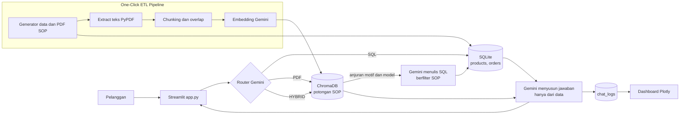

# 🪷 Serat Karsa

**Hybrid RAG (Text-to-SQL + Vector Search) untuk layanan pelanggan, One-Click ETL Pipeline, dan Inventory & Chat Analytics Dashboard untuk bisnis batik modern.**


> Serat Karsa menenun data katalog terstruktur (SQL) dan dokumen SOP tidak terstruktur (PDF) menjadi layanan pelanggan otomatis dan *insight* bisnis.


---

## Masalah yang diselesaikan

Toko batik online menerima pertanyaan berulang setiap hari: stok ukuran tertentu, status pesanan, syarat tukar ukuran, cara mencuci batik tulis, sampai motif yang pantas untuk kondangan. Jawabannya tersebar di dua tempat yang berbeda sifatnya:

| Jenis pertanyaan | Sumber jawaban | Teknik |
| :--- | :--- | :--- |
| Harga, stok, ukuran, status pesanan | Database (tabel) | **Text-to-SQL** |
| Retur, perawatan, makna motif, promo | Dokumen SOP (PDF) | **Vector RAG** |
| "Batik untuk wisuda yang ready ukuran L" | Keduanya | **Hybrid** |

Chatbot biasa yang hanya memakai LLM akan mengarang harga dan stok. Serat Karsa mengambil data dulu, lalu meminta LLM menjawab **hanya** dari data tersebut.

## Fitur utama

### 1. Smart Hybrid Chatbot
- **Router berbasis Gemini** memilih rute `SQL`, `PDF`, `HYBRID`, atau `UMUM`, sekaligus menulis kueri SQL dalam satu panggilan agar hemat kuota.
- **Rute HYBRID mencari SOP lebih dulu**, lalu menulis SQL dengan filter model dan motif sesuai anjuran SOP. Contoh: untuk kondangan hanya motif Truntum dan Sekar Jagad yang diambil dari database.
- **Panel transparansi "Lihat Proses Data"** di bawah setiap jawaban menampilkan rute, kueri SQL, tabel hasil, dan kutipan SOP beserta skor kemiripannya.

### 2. One-Click ETL Pipeline (Data Engineering)
- **Extract:** membuat data katalog dan pesanan, lalu membaca teks dari semua PDF di `data/sop/`.
- **Transform:** merapikan teks dan memotongnya menjadi *chunk* ±700 karakter dengan *overlap* 150 karakter, dipotong di akhir kalimat.
- **Load:** memuat tabel ke SQLite dan *embedding* ke ChromaDB.
- Progress bar di sidebar, upload PDF SOP baru, dan pengelolaan (hapus) dokumen tanpa menyentuh kode.

### 3. Inventory & Chat Analytics Dashboard (Data Science)
- Perbandingan stok dan rata-rata harga 11 model batik Pria vs Wanita.
- **Low-Stock Alert** untuk SKU dengan stok di bawah 5 pcs, bisa disaring per kategori.
- Distribusi kategori pertanyaan pelanggan, tren harian, dan sumber data yang dipakai chatbot, diambil dari tabel `chat_logs`.


---

## Arsitektur



## Tech stack

| Kategori | Teknologi | Peran |
| :--- | :--- | :--- |
| Bahasa | Python 3.12, SQL | Logika aplikasi dan kueri data |
| Database relasional | SQLite | Katalog 165 SKU, 25 pesanan, riwayat chat |
| LLM dan embedding | Google Gemini API (`google-genai`) | Router, Text-to-SQL, penyusun jawaban, embedding |
| Vector database | ChromaDB (lokal, *cosine similarity*) | Pencarian semantik potongan SOP |
| Pemrosesan data | Pandas, PyPDF, fpdf2 | ETL, analitik, pembuatan dan pembacaan PDF |
| Antarmuka | Streamlit, Plotly | Web app interaktif dan grafik |

## Struktur folder

```text
SeratKarsa/
├── .streamlit/config.toml   # tema warna batik pesisir
├── data/
│   ├── sop/                 # PDF SOP (ikut di-commit)
│   ├── serat_karsa.db       # dibuat oleh ETL (tidak di-commit)
│   └── chroma_db/           # dibuat oleh ETL (tidak di-commit)
├── docs/                    # screenshot untuk README
├── etl_pipeline.py          # Extract-Transform-Load SQL dan PDF
├── rag_sql_engine.py        # router hybrid, Text-to-SQL, vector search
├── app.py                   # tampilan Streamlit
├── scripts/
│   ├── cek_setup.py         # tes koneksi Gemini
│   └── cek_model.py         # daftar model Gemini yang tersedia untuk API key
├── eval/
│   ├── pertanyaan_uji.json  # 25 pertanyaan berlabel rute
│   └── evaluasi.py          # akurasi router, SQL, dan pencarian SOP
├── tests/
│   └── test_validasi_sql.py # tes pagar pengaman Text-to-SQL
├── requirements.txt
└── .env.example             # contoh konfigurasi
```

## Skema database

| Tabel | Isi | Kolom penting |
| :--- | :--- | :--- |
| `products` | 11 model × 3 motif × 5 ukuran = 165 SKU | `nama_model`, `kategori`, `motif`, `jenis_kain`, `teknik`, `ukuran`, `harga`, `stok` |
| `orders` | Pesanan `#SK-101` sampai `#SK-125` | `order_id`, `status`, `kurir`, `no_resi`, `product_id` |
| `chat_logs` | Riwayat pertanyaan pelanggan | `waktu`, `pertanyaan`, `kategori`, `sumber_data` |

---

## Cara menjalankan

**Prasyarat:** Python 3.12 dan API key Gemini gratis dari [Google AI Studio](https://aistudio.google.com/apikey).
Python 3.13 ke atas belum disarankan karena beberapa dependensi ChromaDB belum menyediakan *wheel* siap pakai.

```bash
# 1. Clone dan masuk ke folder
git clone https://github.com/zidnyilmannafi26/SeratKarsa.git
cd SeratKarsa

# 2. Buat dan aktifkan virtual environment
python -m venv venv
venv\Scripts\activate          # Windows
source venv/bin/activate       # macOS / Linux

# 3. Install dependensi
pip install -r requirements.txt

# 4. Salin .env.example menjadi .env, lalu isi GEMINI_API_KEY
copy .env.example .env         # Windows
cp .env.example .env           # macOS / Linux

# 5. Bangun database dan vector DB
python etl_pipeline.py

# 6. Jalankan aplikasi
python -m streamlit run app.py
```

Jika model di `.env` tidak tersedia untuk API key Anda, jalankan `python scripts/cek_model.py` untuk melihat model yang bisa dipakai.

## Contoh pertanyaan

| Pertanyaan | Rute | Yang terjadi |
| :--- | :--- | :--- |
| Kemeja batik lengan panjang ukuran L masih ada? | SQL | Filter model, ukuran, dan `stok > 0` |
| Pesanan #SK-103 sudah sampai mana? | SQL | `JOIN orders` dan `products` dengan satu nomor order |
| Kalau kekecilan, syarat tukar ukurannya apa? | PDF | Kutipan SOP retur: maksimal 3 hari dan wajib video unboxing |
| Batik wanita untuk kondangan yang ready ukuran M | HYBRID | SOP dicari dulu, lalu SQL difilter ke motif Truntum dan Sekar Jagad |
| Ada promo akhir tahun? | PDF | Diambil dari PDF promo yang diunggah lewat sidebar |

---

## Keputusan teknis dan pelajaran

**1. Pengaman Text-to-SQL berlapis.** SQL buatan LLM tidak langsung dipercaya. Hanya satu pernyataan `SELECT` yang diizinkan, kata kunci seperti `DROP` dan `DELETE` ditolak, tabel `chat_logs` diblokir, dan kueri dijalankan lewat koneksi SQLite *read-only* (`mode=ro`). Data pesanan hanya bisa dibuka dengan filter `order_id = '#SK-xxx'`, sehingga pelanggan tidak bisa melihat pesanan orang lain.

**2. Konteks yang tidak lengkap membuat jawaban keliru walau SQL-nya benar.** Pada versi awal, SQL sudah memfilter `ukuran = 'L'`, tetapi kolom `ukuran` tidak ikut di-`SELECT`. LLM penyusun jawaban lalu mengira stok tidak dicatat per ukuran. Solusinya: kolom inti wajib diambil dan kueri penyaring ikut dikirim ke prompt jawaban.

**3. Aturan bisnis yang penting ditegakkan di SQL, bukan di prompt.** Instruksi "jangan tawarkan motif Parang untuk kondangan" di prompt tetap dilanggar oleh model kecil. Rute HYBRID diubah agar SOP dicari lebih dulu, lalu dipakai untuk menulis filter `motif IN (...)`. Baris yang tidak sesuai tidak pernah sampai ke LLM, jadi tidak mungkin ikut ditawarkan.

**4. Tahan terhadap gangguan API gratis.** Error `503 UNAVAILABLE` dan `429` sering muncul di tier gratis. Setiap panggilan otomatis dicoba ulang dan berpindah ke model cadangan (`GEMINI_MODEL_CADANGAN`). Nama model disimpan di `.env` karena daftar model Gemini berubah cukup sering.

**5. ETL idempotent.** Menjalankan ETL berkali-kali tidak menggandakan data. Tabel `products` dan `orders` dibuat ulang, koleksi ChromaDB dihapus lalu diisi ulang, sedangkan `chat_logs` dipertahankan karena berisi riwayat interaksi asli.

**6. Model embedding dicatat di metadata koleksi.** Pertanyaan harus diubah menjadi vektor dengan model yang sama seperti saat ETL. Nama model disimpan di metadata ChromaDB sehingga engine selalu memakai model yang cocok.

## Pengujian dan evaluasi

**Unit test (tanpa API key).** Menguji pagar pengaman Text-to-SQL terhadap kueri berbahaya: `DROP`, multi-statement, `UNION` ke `sqlite_master`, akses `chat_logs`, dan kebocoran data pesanan (`OR 1=1`, `LIKE '#SK-%'`). Dijalankan otomatis oleh GitHub Actions di setiap push.

```bash
python -m unittest discover tests -v
```

**Evaluasi chatbot (butuh API key dan ETL).** 25 pertanyaan berlabel rute (SQL, PDF, HYBRID, UMUM) di `eval/pertanyaan_uji.json`. Skrip mengukur akurasi router, persentase SQL yang berhasil dijalankan, dan persentase pertanyaan SOP yang mendapat kutipan. Detail per pertanyaan disimpan ke `eval/hasil_evaluasi.csv`.

```bash
python eval/evaluasi.py
```

| Metrik | Hasil |
| :--- | :--- |
| Akurasi router | **25/25 (100%)**: SQL 9/9, PDF 9/9, HYBRID 4/4, UMUM 3/3 |
| SQL berhasil dijalankan | **12/13 (92%)**: satu gagal karena API Gemini `503 UNAVAILABLE`, bukan karena kueri salah |
| SOP ditemukan | **13/13 (100%)** |

Hasil di atas diambil dari satu kali run dengan `gemini-3.1-flash-lite` (lihat `eval/hasil_evaluasi.csv`). Dengan 25 soal, angka ini menunjukkan sistem berjalan benar, tetapi belum cukup untuk klaim statistik yang kuat.

## Tentang data

Semua data katalog (165 SKU), pesanan (25 order), nama pelanggan, dan dokumen SOP adalah **data sintetis** buatan generator di `etl_pipeline.py` dengan *seed* tetap agar hasil bisa direproduksi. Tidak ada data pelanggan asli. Untuk data nyata, cukup ganti fungsi generator dengan pembaca ekspor toko (CSV, API marketplace, atau database POS); tahap Transform dan Load tidak berubah.

## Keterbatasan dan rencana

- **Validasi SQL berbasis regex.** Cukup untuk kueri buatan LLM dan dilapisi koneksi *read-only*, tetapi bukan parser SQL penuh. Rencana: parsing dengan `sqlglot` dan *allowlist* tabel/kolom.
- **Privasi pesanan mengandalkan nomor order.** Siapa pun yang tahu nomornya bisa melihat status. Toko nyata perlu verifikasi tambahan (email atau nomor HP).
- **Belum ada login.** Sidebar admin (ETL, upload SOP) terlihat oleh semua pengguna.
- **SQLite dan ChromaDB lokal.** Cocok untuk demo satu pengguna. Untuk produksi, pindah ke PostgreSQL + pgvector.
- **Bergantung pada Gemini tier gratis.** Kena batas kuota dan latensi; evaluasi diberi jeda antarpertanyaan.
- Rencana lain: deploy ke Streamlit Community Cloud dan evaluasi kualitas jawaban (bukan hanya rute).

---

Dibuat oleh **[zidnyilmannafi26](https://github.com/zidnyilmannafi26)** sebagai proyek portofolio Data Engineer / Data Scientist.
